<p align="center">
  <picture>
    <source media="(prefers-color-scheme: dark)" srcset="docs/assets/schwab-refresh-hero-dark.svg">
    <source media="(prefers-color-scheme: light)" srcset="docs/assets/schwab-refresh-hero-light.svg">
    
  </picture>
</p>

<h1 align="center">schwab-refresh</h1>

<p align="center"><em>Hands-free Charles Schwab OAuth refresh — a fresh 7-day token, zero clicks.</em></p>

<p align="center">
  
  
  
  
  
</p>

---
BAD NEWS:  I am working on this.  Codex will refuse to install this for you. Schwab-Refresh says in the project it is bypassing OAuth security or something. So you need to install this yourself or use DeepSeek.

Unattended Charles Schwab OAuth token minting. Runs a real browser through
Schwab's login → MFA → consent → account-link flow, captures the authorization
code locally, exchanges it, and writes the result in the **schwab-py token
file format** your other tools already read.

Built after studying [`weig/schwab_cli`](https://github.com/weig/schwab_cli) and
[`weig/webauto-cli`](https://github.com/weig/webauto-cli) — see
[How this relates to schwab_cli](#how-this-relates-to-schwab_cli) for what was
kept, what was changed, and why.

```
schwab-refresh login      # full round-trip, mints a NEW 7-day refresh token
schwab-refresh refresh    # refresh grant if it works, full login otherwise
schwab-refresh token      # print a valid access token (for pipes / scripts)
schwab-refresh status     # ages, budgets, config sanity
schwab-refresh doctor     # environment check (+ --selftest)
```

## Why this exists

Schwab's OAuth has two clocks:

| Token | Lifetime | How you renew it |
| --- | --- | --- |
| access token | 30 minutes | `grant_type=refresh_token` |
| **refresh token** | **7 days** | **only a full browser authorization** |

A refresh grant returns the *same* refresh token with its *original* expiry —
it resets nothing. So any long-running Schwab consumer dies roughly weekly
until someone logs in through a browser again. That weekly browser login is
what this tool automates.

## How it works

```
        authorize URL (client_id, redirect_uri, state)
   us ──────────────────────────────────────────────► api.schwabapi.com
                                                        │
        Chrome (SeleniumBase UC driver, persistent      │ login page
        profile, headless)                              ▼
   browser ◄────────────── drive: login → MFA → trust device
        │                     → consent → accounts → Done
        │
        │ Chrome follows the redirect to
        │ https://127.0.0.1:8182/?code=…&state=…
        ▼
   local HTTPS callback server  ──►  code
        │
        ▼
   POST /v1/oauth/token  ──►  access_token + NEW refresh_token
        │
        ▼
   token.txt  (schwab-py format, atomic replace + .bak)
```

### The four things that actually make it work

These are the parts that are not obvious, and they are exactly what
`schwab_cli`/`webauto-cli` figured out:

1. **SeleniumBase UC mode, not plain Selenium and not Playwright.**
   Schwab sits behind Akamai. Stock chromedriver gets blocked; UC mode ships a
   patched driver plus stealth browser flags. Playwright is webauto's default
   for *generic* sites, but every Schwab example pins `browser="seleniumbase"`,
   and `schwab_cli` hard-sets `WEBAUTO_BROWSER=seleniumbase` for the same reason.

2. **`uc_open_with_reconnect(url, 4)`.**
   Open the page, close the blank tab, detach the debugger, reconnect. Akamai
   flags sessions where the driver is actively attached during navigation.

3. **A persistent Chrome profile.**
   The "remember this device" cookie is the whole game. With it, Schwab skips
   the app-push MFA on later logins; without it, every run needs a phone tap.
   The profile lives at `<state-dir>/chrome-profile` and is deliberately never
   wiped between runs.

4. **JS event dispatch for form fields.**
   Schwab's Angular reactive forms ignore `send_keys` — the model never binds.
   The tool sets `value` and fires `input`/`change`/`blur`, which is what a
   human keystroke looks like to Angular.

Two more that are specific to this implementation:

5. **No OS trust-store installation.** `schwab_cli` installs a local root CA
   into the macOS keychain (`schwab cert install`) so the browser trusts the
   loopback callback. There is no clean, admin-free Windows equivalent, so this
   tool generates a self-signed leaf for `127.0.0.1`/`localhost` and launches
   Chrome with `--ignore-certificate-errors` + `--allow-insecure-localhost`.
   The page loads, the URL keeps `?code=`, and the callback server receives the
   request. No admin, no certificate store surgery.

6. **A page dispatcher, not a linear step list.** The reference scripts use a
   fixed `PageAction` sequence. That breaks the moment a trusted device skips
   MFA, or Schwab reorders consent/accounts — both of which happen. This tool
   matches on the current URL each poll and retries a page if its click did not
   take (Angular hydration races are real). Unknown pages produce a screenshot
   + HTML dump instead of a 10-minute hang.

## Quick start

```powershell
uv sync
copy .env.example .env      # client id/secret, callback, token path, login pair
uv run schwab-refresh doctor --selftest

# first real run: visible window + your phone in hand (see MFA below)
uv run schwab-refresh login --visible

# after that, this should be fully unattended
uv run schwab-refresh refresh
```

`doctor --selftest` launches headless Chrome against the loopback callback with
a fake `code=` and asserts it round-trips. If that passes, the TLS/port/browser
half of the pipeline is good; the only remaining variables are Schwab's own
pages.

## ONE TIME MFA: have your phone ready

**The tool cannot approve the second factor for you.** For an unrecognised
device, Schwab sends a push notification to the **Schwab Mobile app**; you tap
Approve on the phone. Everything around that tap is automatic.

### Before the first run

1. Install **Schwab Mobile** on your phone and sign in once.
2. Allow notifications for the app (a muted phone is the #1 cause of timeouts).
3. Know your app unlock method — Schwab asks you to confirm with biometrics or
   your app PIN when you approve.
4. Keep the phone within reach for the next 2 minutes.

### What happens, step by step

| # | Where | What |
| --- | --- | --- |
| 1 | browser | login ID + password typed, submitted |
| 2 | browser | authenticator screen appears; the **Schwab app** option is clicked for you |
| 3 | **your phone** | push arrives in ~5–15 s: *“Are you trying to log in?”* → **Approve / Yes, it's me** |
| 4 | browser | *trust this device* → consent → account selection → Done (all automatic) |
| 5 | local | redirect captured, code exchanged, `token.txt` rewritten |

The tool waits up to `--mfa-timeout` (default **180 s**, `SCHWAB_REFRESH_MFA_TIMEOUT`)
for the tap. Run it in a visible window the first time (`--visible`) so you can
watch the page sit on "waiting for approval".

If you never approve, the run exits non-zero with
`timed out waiting for the mobile app approval` — exit code `3` from `refresh`,
`4` from `login`. Nothing is corrupted; the previous token file is untouched.

### Why you are asked only once

Step 4 clicks **“remember this device”**, which stores a trust cookie in
`<state>/chrome-profile`. Later runs go straight from password → consent with
**no phone prompt** — the log simply never shows a `/mobile_approve` page. That
is the unattended mode.

You will be asked again when the device stops looking familiar: a Chrome major
version jump, a deleted/reset profile, a big network or geo change, or a Schwab
risk decision. When that happens the run still works — it just needs the phone
tap again, within the timeout.

### If you cannot use the app push

Run `login --manual --visible` and complete the MFA step by hand in the browser
window. The trust cookie is still stored, so later `refresh` runs are silent.
(SMS/voice/code fallbacks are not driven by this tool; `--manual` covers them.)

### Why this is still safe

Password (something you know) **plus** phone approval (something you have). The
tool never sees or stores an MFA code and cannot approve its own push. The push
is your veto: if you did not start a run, decline it.

## Scheduling

`refresh` is idempotent by design, so schedule it **daily** and forget it:

- access token still valid (> 5 min) → 1-second no-op, no network call
- access token stale → `refresh_token` grant, ~2 s
- refresh token inside its last **6 hours**, or Schwab rejects the grant →
  full browser login (this is the run that needs your phone)

Most days the task does nothing at all.

### Option A — one command

```powershell
$proj = "$env:USERPROFILE\Bionic-Projects\Schwab-Refresh"   # your folder
schtasks /Create /TN "SchwabRefresh" /SC DAILY /ST 06:30 `
  /TR "`"$proj\refresh.cmd`"" /RL LIMITED /F
```

`06:30` is a good default: after the token's 7-day expiry could land, before
the US open, and clear of any post-close jobs.

### Option B — Task Scheduler GUI

1. **Task Scheduler → Create Task** (not *Basic Task*).
2. **General** — name it `SchwabRefresh`, choose **Run only when user is logged
   on** (see the note below), tick *Do not start a new instance* under Settings.
3. **Triggers** — New → Daily, 06:30 → tick **Run task as soon as possible
   after a scheduled start is missed**.
4. **Actions** — New → *Start a program*:
   - Program: `C:\path\to\Schwab-Refresh\refresh.cmd`
   - Start in: `C:\path\to\Schwab-Refresh` (must be the project folder so
     `.env` is found)
5. **Conditions** — if the computer runs on battery, untick *Start the task only
   if the computer is on AC power*; optionally tick *Wake the computer to run
   this task*.
6. **Settings** — tick *If the task fails, restart every 10 minutes, up to 2
   times* if you want resilience against a transient network blip.

### “Run only when user is logged on” vs “whether or not”

Headless Chrome is reliable inside your interactive session and unreliable in
session 0 (the non-interactive session Task Scheduler uses when you are logged
off). For a battery-powered computer, the logged-on trigger + *run missed task*
+ *wake* is the combination that actually fires. If you need logged-off
operation, test it there first — Chrome and the UC driver are the parts that
break.

### Verify it worked

```powershell
schtasks /Run /TN "SchwabRefresh"          # trigger immediately
schtasks /Query /TN "SchwabRefresh" /V /FO LIST |
  Select-String "Last Run Time","Last Result","Status"
```

*Last Result `0`* means success. Then confirm the token itself:

```powershell
uv run schwab-refresh status --verify
```

Logs are one file per run in `%LOCALAPPDATA%\schwab-refresh\logs\` (last 30
kept), so a failed 06:30 run is diagnosable the same morning.

### Exit codes (what Task Scheduler reports)

| Code | Meaning | Usual cause |
| --- | --- | --- |
| `0` | success (or nothing to do) | — |
| `2` | configuration | missing env/`.env`, port busy |
| `3` | interactive login required | refresh token dead, MFA not approved |
| `4` | browser/automation failure | Akamai block, selector drift |
| `5` | token endpoint failure | Schwab outage, revoked app |

### Change or remove

```powershell
schtasks /Change /TN "SchwabRefresh" /ST 07:00
schtasks /Delete /TN "SchwabRefresh" /F
```

## Commands

| Command | Purpose |
| --- | --- |
| `login` | Full OAuth round-trip. `--manual` leaves the form to you; `--prompt-credentials` asks at the terminal; `--no-write` skips saving. |
| `refresh` | Refresh grant → full login fallback. `--force` skips the refresh; `--refresh-only` never opens a browser. |
| `token` | Prints a valid access token to stdout (refreshes it if it expires within 2 min). |
| `status` | Token ages/budgets, config echo, callback port availability. `--verify` probes market data + trader endpoints. |
| `doctor` | Chrome/SeleniumBase/env checks. `--selftest` exercises TLS + callback + browser. |

Common flags: `--env-file`, `--token-path`, `--state-dir`, `--visible`,
`--headless`, `--timeout`, `--mfa-timeout`, `--fresh-profile`, `--verbose`,
`--quiet`, `--json`, `--print-token`.

Exit codes: `0` ok · `2` config · `3` interactive login required · `4`
browser/automation failure · `5` token endpoint failure.

## Where settings come from

Every setting is an **environment variable**. Values in a `.env` file are read
as a fallback, so a variable already present in the environment always wins
over the same name in `.env`. CLI flags win over both.

### Token path resolution

The token is written to the first of these that is set. Steps 2–4 are
**environment variables**; step 1 is a CLI flag:

1. `--token-path` (CLI flag)
2. `SCHWAB_TOKEN_PATH` (environment variable)
3. `SCHWAB_TOKEN_FILE` (environment variable)
4. `SCHWAB_TOKEN_JSON` (environment variable)

If none is set, `login` and `refresh` stop with a configuration error and
`status` reports the missing path. When several are set, the higher one wins
and the others are ignored — they are never merged.

### All settings

Each row is “environment variables, first match wins”:

| Setting | Environment variables | CLI override |
| --- | --- | --- |
| client id | `SCHWAB_API_KEY`, `SCHWAB_APP_KEY`, `SCHWAB_CLIENT_ID` | — |
| client secret | `SCHWAB_APP_SECRET`, `SCHWAB_CLIENT_SECRET` | — |
| redirect URI | `SCHWAB_CALLBACK_URL`, `SCHWAB_REDIRECT_URI`, `SCHWAB_REDIRECT_URL` | — |
| login id | `SCHWAB_USERNAME`, `SCHWAB_LOGIN_ID`, `SCHWAB_USER` | — |
| password | `SCHWAB_PASSWORD`, `SCHWAB_LOGIN_PASSWORD` | — |
| **token file** | `SCHWAB_TOKEN_PATH`, `SCHWAB_TOKEN_FILE`, `SCHWAB_TOKEN_JSON` | `--token-path` |
| state directory | `SCHWAB_REFRESH_STATE_DIR` | `--state-dir` |
| Chrome profile | `SCHWAB_REFRESH_PROFILE_DIR` | (`--fresh-profile` uses a throwaway one) |
| headless | `SCHWAB_REFRESH_HEADLESS` | `--visible` / `--headless` |
| MFA wait | `SCHWAB_REFRESH_MFA_TIMEOUT` | `--mfa-timeout` |
| login budget | `SCHWAB_REFRESH_LOGIN_TIMEOUT` | `--timeout` |
| accept loopback cert | `SCHWAB_REFRESH_IGNORE_CERT_ERRORS` | — |

### Password at rest

The first command that loads a **plaintext** `SCHWAB_PASSWORD` from `.env`
rewrites that line in place as an encrypted envelope:

```
SCHWAB_PASSWORD=$$dpapi:AQAAANCMnd8BFdERjHoAwE/Cl+sBAAAA…$$
```

* `dpapi` — default on Windows. Windows DPAPI binds the blob to your Windows
  user account, so another account (or the same file on another PC) cannot
  open it. Nothing to manage, no key file.
* `aes` — fallback off Windows. AES-GCM with a random key at
  `<state>/secret.key` (mode 0600). It keeps the password out of the open, but
  the key lives in your profile, so treat it as protection at rest rather than
  account binding.

The value is decrypted in memory at login time and never written back as
plaintext. No extra command is needed — the next `login`, `refresh`, `status`
or `doctor` run does it and prints a one-line note.

Two consequences worth knowing:

* Copying `.env` to another Windows account or PC: a `dpapi` envelope will not
  open there, and the tool says so before touching the login form. Put the
  plaintext back (it re-encrypts locally) or use `--prompt-credentials`.
* A password supplied through the process environment is left alone — it is
  not in the file, so there is nothing to rewrite.

## What gets written where

| Path | Contents |
| --- | --- |
| resolved token file (see above) | schwab-py token JSON (`creation_timestamp` + `token{…}`), atomic replace, `.bak` kept |
| `<state>/chrome-profile/` | persistent Chrome profile — **do not delete** unless you want to re-do MFA |
| `<state>/tls/` | self-signed loopback cert/key |
| `<state>/secret.key` | only when the password used the AES fallback (non-Windows) |
| `<state>/logs/` | one log per run, last 30 kept |
| `<state>/diagnostics/` | screenshots + HTML dumps on unexpected pages (only with `--verbose`) |
| `<state>/refresh.lock` | prevents two refreshes at once (stale > 60 min is taken over) |

On Windows the state directory is `%LOCALAPPDATA%\schwab-refresh`.

## How this relates to schwab_cli

| Concern | `schwab_cli` + `webauto-cli` | this tool |
| --- | --- | --- |
| Browser engine | SeleniumBase UC (pinned via `WEBAUTO_BROWSER`) | same |
| Driver technique | `uc_open_with_reconnect`, persistent profile, JS dispatch | same |
| Flow shape | fixed `PageAction` list per script | URL-keyed dispatcher with retries |
| Callback | local HTTPS server + root CA in the macOS keychain | local HTTPS server + self-signed leaf + `--ignore-certificate-errors` (no admin) |
| Packaging | two projects, encrypted env files, notification listener | one package, env vars, no subprocess hop |
| Output | `~/.config/schwab_cli/session.json` | schwab-py `token.json` (what downstream tools read) |
| Credentials | webauto encrypted env | env / `.env` with a `$$…$$` encrypted password |

What was intentionally **not** copied: the remote notification listener, the
config/session schema, and the root-CA install. None of them buy anything for a
single-purpose Windows refresher.

## Security notes

- `.env` is gitignored; the token file is written `0600` where the filesystem
  supports it (OneDrive/Windows ACLs govern in practice).
- Your Schwab password is encrypted at rest in `.env` (`$$dpapi:…$$`, bound to
  your Windows user account) and decrypted only in memory.
  `--prompt-credentials` keeps it out of the file entirely; Windows Credential
  Manager or an encrypted volume are further options.
- The token file contains a bearer credential valid for 30 minutes plus a
  refresh token valid for 7 days. Treat it like a password.
- `--verbose` dumps page HTML on failures. Schwab's login page source does not
  include the password, but treat those dumps as sensitive anyway.
- MFA is your veto: if a push arrives and you did not start a run, decline it.

## Troubleshooting

| Symptom | Fix |
| --- | --- |
| No push notification arrives | Check app notifications/permissions on the phone; open Schwab Mobile once and retry. |
| `timed out waiting for the mobile app approval` | Approve within `--mfa-timeout`, or raise it (`--mfa-timeout 300`). If pushes never arrive, use `login --manual --visible`. |
| Push arrives on every run | The trust cookie is not surviving: don't delete `<state>/chrome-profile`, check Chrome isn't running with a locked profile, and re-run `login --visible`. |
| `Access Denied` / "blocked page detected" | Retry with `--visible`; if it persists, `--fresh-profile`. Akamai occasionally flags headless UC. |
| `cannot bind 127.0.0.1:8182` | Something else owns the callback port (often an old schwab-py flow). Close it or register a new callback URL. |
| `unexpected page during login` | Schwab changed the flow or added a verification step. Run `--verbose --visible` and inspect the diagnostics dump; selectors live at the top of `schwab_refresh/flow.py`. |
| Browser never shows the callback | Check `SCHWAB_CALLBACK_URL` matches the portal **exactly**, including the trailing path. Run `doctor --selftest`. |
| Refresh token rejected every run | The stored refresh token is older than 7 days. `refresh` should fall back to a full login automatically; check the log for the fallback line. |

## Development

```powershell
uv sync
uv run pytest            # 33 tests, no network/browser needed for the suite
uv run schwab-refresh doctor --selftest
```

Layout:

```
schwab_refresh/
  cli.py         command surface, orchestration, exit codes
  config.py      env/.env loading, aliasing, validation
  oauth.py       authorize URL, code exchange, refresh grant, probe
  secretbox.py   $$…$$ password envelope (DPAPI / AES-GCM) + .env rewrite
  browser.py     SeleniumBase UC wrapper (goto/fill/click/check/wait)
  callback.py    loopback HTTPS server + self-signed cert
  flow.py        Schwab page state machine
  tokenstore.py  schwab-py token file read/write/atomic
  logsetup.py    console + file logging
tests/           fake-browser flow tests, token/config unit tests
docs/assets/     README hero, dark + light SVG variants
```

## Prerequisites

Everything below must be in place before the first run. `doctor --selftest`
checks most of it automatically.

### On the computer

| Requirement | Why | Check |
| --- | --- | --- |
| **Windows 10/11 (x64)** | built and verified here; the scheduling guidance is Windows-specific | `winver` |
| **Python 3.11 or newer** (verified on 3.12) | runtime | `python --version` |
| **[uv](https://docs.astral.sh/uv/)** | creates the venv and pins dependencies | `uv --version` |
| **Google Chrome (stable channel)** | SeleniumBase drives it; the matching `chromedriver` and `uc_driver` are downloaded automatically on first launch | `(Get-Item "$env:ProgramFiles\Google\Chrome\Application\chrome.exe").VersionInfo.ProductVersion` |
| **A free loopback port** matching the callback (default `8182`) | the OAuth redirect lands there | `schwab-refresh status` → `callback_port_free` |
| **Outbound HTTPS** | `api.schwabapi.com` (OAuth, market data), `client.schwab.com` / `sws-gateway.schwab.com` (login), `storage.googleapis.com` (first-run driver download) | open any of them in a browser |

No administrator rights are required: no certificate-store changes, no
services, no system-wide installs.

If you prefer not to use uv: `python -m venv .venv` then
`.venv\Scripts\pip install -e .` gives the same result.

### On the Schwab side

| Requirement | Why |
| --- | --- |
| A **Schwab developer app** (client id + secret) | the OAuth client credentials |
| The app's callback registered **exactly** as `SCHWAB_CALLBACK_URL` — scheme, host, port and path | Schwab rejects any mismatch at the authorize step |
| The app approved with **Accounts and Trading**, not market-data only | the trader endpoints and the streamer scope need it (`status --verify` proves both) |
| **Schwab Mobile** on your phone, notifications enabled | the one-time MFA push when the device is not trusted yet |

### Installed for you by `uv sync`

| Package | Version floor | Role |
| --- | --- | --- |
| `seleniumbase` | ≥ 4.27 (4.59 verified) | UC-mode Chrome driver — the part that gets past Akamai |
| `selenium` | pulled in by seleniumbase | WebDriver API |
| `cryptography` | ≥ 42 (50.0 verified) | self-signed loopback cert + AES-GCM fallback for the password |
| `httpx` | ≥ 0.27 (0.29 verified) | token endpoint calls, `--verify` probes |
| `python-dotenv` | ≥ 1.0 (1.2 verified) | `.env` loading |
| `pytest` | ≥ 8 (9.1 verified) | test suite (dev group) |

### Bundled with Windows

| Component | Used for |
| --- | --- |
| `cmd.exe` | `login.cmd`, `refresh.cmd` |
| Task Scheduler (`schtasks.exe`) | the daily refresh job |

### One-shot verification

```powershell
uv sync
uv run schwab-refresh doctor --selftest
```

`doctor` reports Chrome, SeleniumBase, the four core `SCHWAB_*` variables, the
login pair, the callback port, the state directory and the token file.
`--selftest` additionally launches headless Chrome against the loopback callback
and proves the code round-trips.
